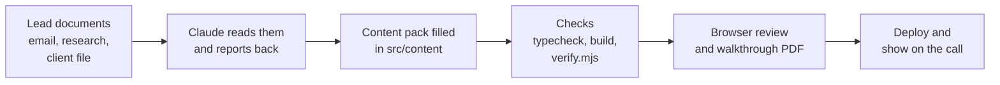

# Pre-Sales Demo Kit (hexaa)

A reusable kit for building a **pre-call demo** for a sales lead in a day, not a month.

One **engine** (the app) and one **content pack** per client. You never rebuild the app for a
new lead. You read the lead's documents, fill in the content pack in `src/content/`, and the
whole demo re-skins itself in the client's own words. Claude Code can do most of that work
for you, guided by the instructions in [`CLAUDE.md`](CLAUDE.md).

Everything in the demo is **simulated**. There is no backend and no real processing. It is a
conversation piece for the first call, not a product.

## Contents

1. [The problem this kit solves](#the-problem-this-kit-solves)
2. [What the kit does](#what-the-kit-does)
3. [What is inside](#what-is-inside)
4. [How it works](#how-it-works)
5. [Prerequisites](#prerequisites)
6. [Quick start: see the example](#quick-start-see-the-example)
7. [Build a demo for a new client](#build-a-demo-for-a-new-client)
8. [What you fill in per client](#what-you-fill-in-per-client)
9. [Project structure](#project-structure)
10. [Commands](#commands)
11. [Deploy](#deploy)
12. [Branding](#branding)
13. [Password lock](#password-lock)
14. [Version history](#version-history)
15. [Testing a demo before you show it](#testing-a-demo-before-you-show-it)

---

## The problem this kit solves

Before a first sales call you usually know three things about a lead: what they said in an
email, what your own research suggests, and maybe one file they sent. What you do **not**
have is a way to show them, in their own words, that you understood their job.

The usual options are poor:

- **Slides** describe a solution in general terms. The lead nods, then forgets.
- **A custom prototype** takes weeks, needs the lead's real data, and is a commitment before
  anyone has agreed what the problem is.
- **A generic demo** shows features nobody asked for, in vocabulary nobody uses.

This kit takes a middle path. For each lead it produces a believable, clickable demo that
uses **their** documents, **their** vocabulary and **their** process, built from research you
already have. The goal is not to impress. The goal is for the lead to look at the screen and
say *"yes, that is how we work"*, or, even better, *"no, that step is wrong"*. A correction on
the first call is worth more to you than agreement, because it tells you what is really
going on.

It fits leads whose work looks like this: **things come in, values are read out, they are
cross-checked, and mismatches are flagged for a human.** Invoices against orders, certificates
against schedules, tender packs against requirements, claims against policies. If a lead's
work is fundamentally different, `CLAUDE.md` tells Claude to stop and say so instead of
forcing the template.

## What the kit does

- Turns a lead's email and research into a **four-page interactive demo**.
- Shows the lead **their own process** first, with nothing of ours in it, so there is nothing
  to argue with and every correction is useful.
- Then shows **the same process with the part you would take over** marked in the accent
  colour. Nothing is added or removed. Only who does the step changes.
- Makes every guess visible with a **guess badge** and a matching **question to ask on the
  call**, so you never present an invention as a fact.
- Lets you **edit the process live** in front of the client, then export it.
- Keeps the human in control: whatever must stay with a person is listed as a boundary, and
  the demo never crosses it.

## What is inside

### The four pages

| Page | What it is for |
|---|---|
| **Project Overview** | The case at a glance: who and what, the values pulled out (each traced to its source paper), what needs attention, what came in, and what stays with a human. Less important detail is tucked into a "More detail" tray. |
| **Intake** | Pick a case, add every document it needs, then run a simulated pipeline that reads, cross-checks and flags. A case will not run on a partial set of documents, which is itself worth showing. |
| **Exceptions** | The document on the left, the findings on the right. Click a finding and the exact value is highlighted in the paper. A finding where two papers disagree shows both sides on their own tabs. Every finding can be edited and approved in place. |
| **Process Flow** | The most important page. An editable diagram with two views of the same work, plus a **Questions** drawer for the call (see below). |

### The two Process Flow views

- **How it runs today** is the client's own process, drawn with standard flowchart symbols
  (start or end, document, step in a system, done by hand, decision). No step of ours appears.
  This is the view to open the call on.
- **Where we would help** is the same work as one left-to-right line, with the part you would
  take over in the accent colour.

In both views the client can click a card to edit it, expand a card to see its steps, add or
delete phases, steps, notes and connections, and export or import PNG and JSON. The page
keeps the viewer's place, so opening a card or the editor does not throw the zoom away.

**Moving cards.** Press on empty canvas and drag to move the whole view. Press on a card and
drag to move just that card, anywhere. Its lines follow it, re-routed so they never run
through another card or on top of another line, with their labels kept clear. Drop a card on
another and it settles beside it. **More, Put cards back in line** undoes every move.

### The Questions drawer

A working list of what to ask on the call, grouped, with the reason for each question. The
first group is always **what we guessed**. Each question can be answered or removed during
the call, and answers are kept for the browser session and can be exported with the flow file.

### Optional sections

Every one of these is optional. Leave it out and the page behaves as before.

- Rename the four pages and their headings in the client's own words.
- A **comparison grid**: one row per value, one column per source paper, the disagreeing cell
  marked.
- A **pack checklist**: what the set must contain, and whether it does.
- Documents that arrived as a **phone photo**, or as a **record from the client's system**.
- Intake extras: a record fetched automatically, and a follow-up after the run (values noted
  back, or a message drafted for a person).
- The client's own **master record** on the Overview, with a guess badge if you invented it.

### The example project

The kit ships with a working example so you can see everything running immediately: a
fictional company, *Northwind Components Ltd*, checking a supplier invoice against its
purchase order and goods-received note. It has deliberate faults (price, quantity, VAT,
payment terms) that the demo flags. A permanent **Sample data** badge is shown on every page.

## How it works



1. **Input.** You give Claude the lead's documents. The email is the client's own voice and
   wins any disagreement. The use-case document is your own research and is treated as a
   best guess, not fact.
2. **Sort the facts.** Every fact that will appear on screen is sorted into *sourced*,
   *inferred* or *filled*. Filled items are marked as guesses and get a question.
3. **Fill the content pack.** Only `src/content/` changes. The shell, the pages, the pipeline
   and the diagram are reused as they are.
4. **Check.** Type-check, build, and the kit's own verifier.
5. **Review.** Look at every page in a browser, then write a short walkthrough PDF for
   whoever runs the call.
6. **Deploy and present.** Open on *How it runs today*, take the corrections, then show
   *Where we would help*.

## Prerequisites

### Software

| Needed | Why |
|---|---|
| **Node.js 18 or newer** (built and tested on Node 22) and **npm** | Runs and builds the app |
| **Git** | Cloning and versioning |
| A code editor such as **VS Code** | Reading and editing content files |
| A modern browser (Chrome or Edge) | Viewing the demo |

### To build demos with Claude (recommended)

| Needed | Why |
|---|---|
| **Claude Code** (CLI, VS Code extension or desktop app) | Reads the documents and fills the content pack |
| The ability to create PDFs (Claude's `pdf` skill) | `CLAUDE.md` asks for a walkthrough PDF at the end |
| *Optional:* Playwright and Chromium | Runs the diagram's automatic browser check (see [Testing](#testing-a-demo-before-you-show-it)) |

### Documents you need for each lead

Gather these **before** you start. Keep them in a folder **outside** the project, so they
can never be committed or shipped.

| Document | Role | How Claude treats it |
|---|---|---|
| **Email thread** with the lead | The client's own voice. What *they* said the problem is. | Trusted most. Wins any disagreement. |
| **Use-case document** | Your own research and assumptions, written before any call. | A best guess, not confirmed fact. The main source the demo is built from. |
| *Optional:* **a file the client sent** | A real invoice, schedule, certificate and so on. | Strong evidence. |
| *Optional:* **a call brief** | Your own call preparation. | Context only. |

There is no call transcript. This demo is what gets shown **on** the first call.

### Accounts (only if you deploy)

A **GitHub** account and a **Vercel** account. Vercel is the suggested host and
[`vercel.json`](vercel.json) is already in place.

## Quick start: see the example

```bash
git clone https://github.com/tehseen-h/hexaa-presales-demo-kit.git
cd hexaa-presales-demo-kit
npm install
npm run dev        # opens on http://localhost:5173
```

Click through all four pages. On *Process Flow*, switch between the two views and open the
**Questions** button.

## Build a demo for a new client

### 1. Start a fresh copy

Each client gets its own project folder. Do **not** work inside this repository.

```bash
git clone https://github.com/tehseen-h/hexaa-presales-demo-kit.git acme-demo
cd acme-demo
rm -rf .git          # Windows PowerShell: Remove-Item -Recurse -Force .git
git init
npm install
```

You can also copy a clean folder from this repository by hand. Copy everything except
`node_modules` and `dist`, then run `npm install` in the copy.

### 2. Open it in Claude Code

Open the new project folder in Claude Code. Claude reads `CLAUDE.md` automatically, but ask it
to read it in full anyway.

### 3. Give Claude the initial prompt

Replace the paths and paste this. It makes Claude **report first and build second**, which is
the single most useful habit for catching a wrong fit early.

```text
Read CLAUDE.md in full before doing anything.

This kit is for a new lead. The GitHub repo is: <company-name>-prototype-hexaa
Their documents are in: <path to the folder with the documents>
- Email thread: <file name>
- Use-case document: <file name>
- Optional, client file or call brief: <file name>

Step 1. Report only. Do not build yet.
1. The lead's core problem in one or two lines, taken from the email.
2. Whether the four-page pattern (things come in, values are read out, they are
   cross-checked, mismatches are flagged for a human) really fits this lead, or what would
   fit better.
3. The domain language you will use on screen.
4. Where "How it runs today" should start: the event that causes their first document to
   exist, and whether you can source it from the documents.
Then wait for my reply.

Step 2. After I agree, work in the phases in CLAUDE.md section 0. Keep your plan and fact
ledger outside the project folder. Sort every fact into sourced, inferred or filled, and give
every filled item a guess badge and a matching question. Change only src/content. Issue the
password lock from the repo name (CLAUDE.md section 4b). Work out
every number with a small script instead of typing it. Run npm run typecheck, npm run build
and node verify.mjs, look at every page in a browser, then write the walkthrough PDF.
```

### 4. Answer Claude's report

If Claude says the lead does not fit the pattern, believe it and discuss. If it fits, correct
anything it got wrong about the language or the starting point, then let it build.

### 5. Review before the call

Do not trust a single pass. Run the checks and the Claude review prompts in
[Testing a demo before you show it](#testing-a-demo-before-you-show-it).

## What you fill in per client

All of this lives in `src/content/`. The TypeScript types guide you, and
[`src/content/README.md`](src/content/README.md) has the field-by-field detail.

| File | What goes in it |
|---|---|
| `project.ts` | Client name, subtitle, "Created by", optional accent colour, identity chips, the human-retains **boundaries**, case summary. Optional page and heading names. |
| `documents.ts` | Each incoming document as a faithful "paper". Give every field you will flag a `key`, on both sides of a comparison. |
| `extracted.ts` | The values pulled out. Each points back to its source document and field. |
| `exceptions.ts` | The findings: severity, detail, suggestion, who it is routed to, and the other side of the disagreement. |
| `intake.ts` | The Intake heading and the **cases**. Each case lists every document it needs. |
| `pipeline.ts` | The simulated stages, in the client's own words. |
| `schedule.ts` | *Optional.* The client's own master record. |
| `questions.ts` | What to ask on the call. The first group must cover every guess. |
| `flowToday.ts` | **The client's own process**, in flowchart symbols, with no step of ours. |
| `flow.ts` | **The same process with our part marked.** Derived from `flowToday.ts`, never written separately. |
| `comparison.ts` | *Optional, create it when needed.* The comparison grid and the pack checklist. Add it to `index.ts`. |

Three rules matter more than the rest:

1. **The documents win.** Where this kit and the lead's documents disagree, the documents win.
2. **Nothing invented looks sourced.** Every guess is badged and has a question.
3. **The flow is derived.** *Where we would help* is *How it runs today* with owners changed.

## Project structure

```text
.
├── CLAUDE.md                  Instructions for Claude: how to turn a lead into a demo
├── README.md                  This file
├── verify.mjs                 The kit's own checker (run: node verify.mjs)
├── vercel.json                Deployment settings
├── package.json               Scripts and dependencies
├── package-lock.json          Exact dependency versions
├── public/                    Logo (hexaa-mark.png) and favicon
├── skills/
│   └── process-flow-diagram/  The bundled diagram skill, templates, verify-flow.mjs, verify-drag.mjs
└── src/
    ├── content/               THE ONLY THING YOU CHANGE PER CLIENT
    ├── pages/                 The four pages (reused as they are)
    ├── components/            Shared pieces such as the document viewer and sidebar
    ├── flow/                  The diagram engine, model and question state
    └── lib/                   Content-pack types, page names, simulated pipeline
```

## Commands

| Command | What it does |
|---|---|
| `npm install` | Installs dependencies (once per copy) |
| `npm run dev` | Dev server on http://localhost:5173 |
| `npm run typecheck` | TypeScript check. Must pass. |
| `npm run build` | Production build into `dist/`. Must pass. |
| `npm run preview` | Serves the production build on port 5000 |
| `node verify.mjs` | The kit's own end-of-project checks |

## Deploy

```bash
npm run build      # output goes to dist/
```

Push the project to GitHub and import it in Vercel. [`vercel.json`](vercel.json) already sets
the framework, build command, output folder and single-page rewrite. `node_modules` and
`dist` are in `.gitignore` and should never be committed.

## Branding

The theme is warm and light: an off-white ground, white cards, a navy collapsible sidebar and
the hexaa amber accent. The logo is the real hexaa mark in `public/hexaa-mark.png`, with the
favicon in `public/favicon.png`. "Created by hexaa" appears automatically in the sidebar and
on the Overview. Per client you normally change only `project.client`. To change the accent,
set `project.accent` in `src/content/project.ts` to a hex such as `#E0A43B`.

## Password lock

Every demo opens on a private login page: the hexaa logo, "A private demo created for
<client>", what the demo shows, who it was prepared for and by, and the date it is available
till. Nothing of the demo is shown, or even downloaded, before the right password.

**The password** is `<company-name>-<hexaa suffix>`. The company name is the repo name without
`-prototype-hexaa` (or `-hexaa-prototype`): the repo `dg-bevan-insurance-prototype-hexaa`
gives `dg-bevan-insurance-<suffix>`. The suffix is the same for every demo and is known only
to hexaa, so hexaa can always work out a demo's password and nobody else can. Typing is
forgiving: capitals and stray spaces are ignored.

**Where the secret lives.** Only on hexaa's machine, in `~/.hexaa/demo-password-suffix`
(on Windows `C:\Users\<you>\.hexaa\demo-password-suffix`), one line. It is never in this repo,
in a client repo, or in a deployed site. To set up a new machine, create that file.

**Issuing a demo's lock** (Claude does this from the repo name):

```bash
npm run access -- --repo dg-bevan-insurance-prototype-hexaa
npm run access -- --test dg-bevan-insurance      # confirms it opens
```

That writes `src/content/access.ts` with the dates and a salted, slow, one-way check value,
never the password. It is safe to commit and deploy as it is: it works on every GitHub push
and Vercel deploy with no settings to add.

**Expiry.** The password works for 14 days from the day it is issued, until the end of the
"Available till" day. After that the login page says the walkthrough has closed, even for a
browser that was logged in. To reopen a demo, re-issue it (`npm run access`, optionally with
`--created YYYY-MM-DD` or `--days N`) and redeploy. Editing the date by hand does not work:
the dates are part of what is hashed.

**Staying logged in.** After the right password, the browser stays in across reloads, closed
tabs and restarts until the last day. It remembers a value derived from the password, never the
password, and a made-up value is refused. "Lock demo" at the bottom of the sidebar logs out.

**What this protects, honestly.** It is a lock on the front door of a static site. It keeps
anyone without the password out of the demo, and the password and hexaa's suffix cannot be
recovered from the site. The demo's text is still inside the site's JavaScript files (fetched
only after unlocking), so a determined technical visitor who downloads those files directly
could read it. Don't put anything in a demo that would be a problem if that happened.

`node verify.mjs` fails if the lock is missing, malformed, expired or still names the wrong
client, and if the suffix appears in any file of the project, build output included.

## Version history

| Commit | What it added |
|---|---|
| **1. Initial kit** | Four pages, content pack, simulated pipeline, read-only swimlane flow, example client, `CLAUDE.md` |
| **2. Editable flow and branding** | Editable diagram, PNG and JSON export and import, real logo and theme, collapsible sidebar, bundled skill, `verify.mjs`, walkthrough PDF step |
| **3. v2** | Two flow views, flowchart symbols, Questions drawer, multi-document Intake cases, two-sided findings, edit and approve, client master record, fact buckets, typecheck, Vercel config, browser checker |
| **4. v3** | Client-worded pages and headings, optional comparison grid, pack checklist, photo and system documents, Intake follow-ups, finding deep links, keep-your-place flow, answerable questions, phased workflow |
| **5. Movable cards** | Drag any card on the Process Flow, lines re-routed around cards and other lines, labels kept clear, drop settles clear of other cards, Put cards back in line, `verify-drag.mjs` |
| **6. Password lock** | Login page, per-project password from the repo name and a private suffix, 14-day expiry, stays logged in until then, Lock demo, `npm run access`, suffix leak check in `verify.mjs` |

## Testing a demo before you show it

A demo is many small decisions that must agree with each other, and the client will judge it
by its details. Test it in three layers: automatic checks, a look in the browser, and a
**fresh Claude review**.

### Layer 1. Automatic checks

```bash
npm run typecheck      # types are sound
npm run build          # the app builds
node verify.mjs        # content checks
```

`verify.mjs` checks that the content is no longer the example, every `fieldKey`, `docId` and
`exceptionId` resolves, both flows are real, *How it runs today* contains no step of ours,
the two flows describe the same process, every guess badge has a question behind it, there are
no em or en dashes in the content pack, a walkthrough PDF exists, the build ran, the password
lock is issued for this client and not expired, and hexaa's password suffix is in no file.

It cannot tell you whether the content is **right**. It only checks that it hangs together.
A warning that the example project is still present, or that no PDF exists yet, is normal
before you have finished.

### Layer 2. Look at it yourself

Run `npm run dev` and check, page by page:

- **Overview** reads as *their* process. Primary values are visible, detail is in the tray.
- **Intake**: a case will not run until every document it needs is added, and the result is
  easy to find.
- **Exceptions**: clicking a finding highlights the exact value, and a two-sided finding shows
  both sides.
- **Process Flow** opens on *How it runs today*. Every line touches both cards it joins, no
  line crosses another, no label is struck through, and every branch is labelled.
- **As a live tool**: draw a link, change a card's symbol or owner, add and delete a step, a
  card, a note and a connection, then export, import and reset.
- **Keeps your place**: zoom somewhere, open a card's steps, close them, and confirm you are
  back where you were.
- **Questions**: answer one, remove one, reload, and confirm both are still there.
- **Moving cards**: drag a card below the line, onto another card and above the line. Its lines
  follow and stay clear of every card and line. A click still opens the editor, empty canvas
  still pans, and **Put cards back in line** restores the original.

Screenshot each page. Layout faults, such as a card hidden behind a scroll position, do not
show up in a type check.

### Layer 3. The automatic diagram check (optional)

`skills/process-flow-diagram/reference/verify-flow.mjs` opens the app in a real browser and
checks the geometry: every line touches both cards, no line crosses an unrelated card, no two
lines touch or cross, every branch is labelled, no label is struck through or hidden, and no
card text overflows.

```bash
npm i -D playwright && npx playwright install chromium
npm run dev
DEMO_COMPANY=<company-name> node skills/process-flow-diagram/reference/verify-flow.mjs
DEMO_COMPANY=<company-name> VIEW=hexaa node skills/process-flow-diagram/reference/verify-flow.mjs
```

Both checkers sign in through the login page themselves. `DEMO_COMPANY` is the company name
from the repo; the password is built from `~/.hexaa/demo-password-suffix`, so it is never typed
on a command line. They open the Process Flow tab themselves too. Always look at the
screenshots they save. They catch what the assertions do not.

`skills/process-flow-diagram/reference/verify-drag.mjs` checks **moving cards** the way a person
would on a call: panning empty canvas, clicking a card, dragging cards below, onto and above
the line, opening every card, reloading, and putting the cards back. After every step it checks
that lines touch both their cards, never run through a card or on top of another line, and that
labels stay clear. It already opens the Process Flow tab itself.

```bash
npm run dev
DEMO_COMPANY=<company-name> node skills/process-flow-diagram/reference/verify-drag.mjs             # How it runs today
DEMO_COMPANY=<company-name> VIEW=hexaa node skills/process-flow-diagram/reference/verify-drag.mjs  # Where we would help
```

It reports a crossing as a WARN, not a failure: a card dropped into a pocket that other lines
enclose cannot be reached without crossing one. Check every WARN on its screenshot.

### Layer 4. Test the content with Claude

The builder is the worst person to check its own work, so use a **separate reviewer**: a new
Claude Code session, or a subagent. Give it the lead's documents and `CLAUDE.md`, but **not**
the builder's conclusions or plan. Ask for findings first and fixes second.

**A. Were the documents read properly?**

```text
You are an independent reviewer and have not seen how this demo was built.
Read CLAUDE.md, then the lead documents in <path>.
For each document, list the facts it states, who said each one (the client, or our research),
and anything that conflicts with another document. Then read src/content and tell me, fact by
fact, what the documents say that the demo misses, gets wrong or distorts. Where the email and
the use-case document disagree, confirm the email won. Report findings only, do not edit.
```

**B. Is the content correct?**

```text
Review src/content against the lead documents in <path>.
1. Recompute every figure on screen independently: prices, quantities, totals, VAT or tax,
   rates, dates and weekdays, identifiers. Do not trust the values as typed.
2. Trace every name, system, team, volume and frequency to a document. Give me a table:
   item | where on screen | source | sourced, inferred or filled | ok?
3. List anything that is filled but not marked assumption: true.
4. Confirm the only wrong numbers are the faults we planted on purpose in exceptions.ts.
```

**C. Is the INITIAL flow step correct?**

```text
Open src/content/flowToday.ts and look only at the first card.
Using only the lead documents, answer: what event causes the first document to exist, and what
makes the client responsible for it? Is the first card that event, or is it only the paperwork
arriving, which is usually one or two steps too late? If the trigger cannot be sourced, is the
card badged assumption: true and does the first group of questions.ts ask about it? Tell me
what the first card should be and why.
```

**D. Is the whole flow correct?**

```text
Audit src/content/flowToday.ts against the lead documents in <path>.
- Is the sequence the real order of work? Which card is in the wrong place?
- Does any card belong to us? There must be no step of ours, no lane: 'ours'.
- Are the symbols right: terminator, document, process, manual, decision?
- Is every branch labelled, and does each decision label both outputs?
- Is there at most one card lifted up and one dropped down, and does each carry a message?
Report findings only.
```

**E. Does "Where we would help" match "How it runs today"?**

```text
Compare src/content/flowToday.ts with src/content/flow.ts.
Build a table: their step | our step | who performs it today | who performs it in ours.
Every step of theirs must appear in ours. Allowed changes are only who performs a step,
splitting one card into a few genuine checks, and one quiet "nothing to raise" card.
Flag any step that vanished, drifted in meaning, moved, or any step of ours that crosses a
boundary in project.boundaries.
```

**F. Is it honest?**

```text
List every assumption: true in flowToday.ts, flow.ts, schedule.ts and comparison.ts. For each,
show the matching question in the first group of questions.ts. Flag any guess without a
question, any question without a guess, and any claim phrased as fact that the documents do
not support. Pay special attention to schedule.ts: a master record is easy to invent whole.
```

**G. Do all pages agree?**

```text
Read every page of the running app and the walkthrough PDF end to end, as a client would.
List every contradiction: a name, number, date, status or sequence that differs between
Overview, Intake, Exceptions, Process Flow, the questions and the PDF. Confirm the PDF
describes every page and section that exists, and nothing that does not.
```

Fix what the reviewer finds, run `node verify.mjs` again, and repeat until the findings are
only things you have decided to accept.
